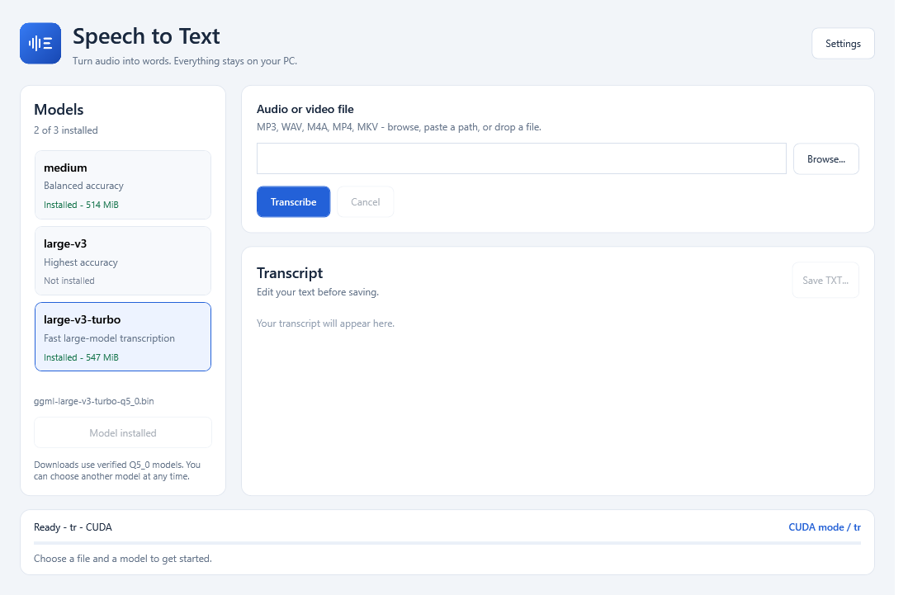
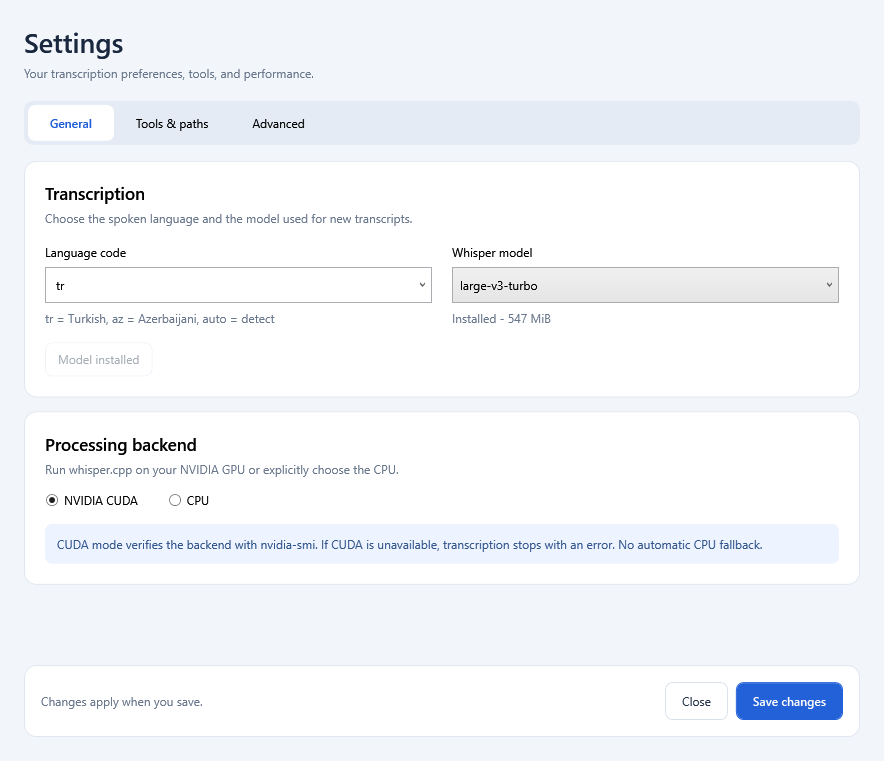

# Speech to Text

**Fast, private audio and video transcription for Windows.**

[](https://github.com/VusalAbdurahmanovX/Speech-to-text/releases/latest)
[](https://dotnet.microsoft.com/)
[](LICENSE)
[](https://github.com/VusalAbdurahmanovX/Speech-to-text/actions/workflows/build.yml)

A Windows desktop app that turns speech in audio and video files into editable text and subtitles, built with **C# / .NET 8 WPF** and the official **[whisper.cpp](https://github.com/ggml-org/whisper.cpp)** backend.

Paste a media path, click **Transcribe**, edit the text, and **Save TXT**. No Python, PyTorch, openai-whisper, or C# reimplementation of Whisper. The app starts `whisper-cli.exe` as a separate process.



## Highlights

- Fast NVIDIA CUDA transcription with verified GPU use; CPU mode is available by explicit selection.
- Local processing with no cloud API, API key, or recording upload.
- MP3, WAV, M4A, MP4, and MKV input with automatic FFmpeg audio preparation.
- Select and download medium, large-v3, or large-v3-turbo from the model library.
- Editable transcripts, automatic TXT/SRT output, live progress, and cancellation.
- Self-contained Windows installer and portable ZIP; no .NET SDK required for end users.

**User-reported performance:** approximately **25 minutes of video transcribed in 50 seconds** on an **NVIDIA RTX 3070 Ti Laptop GPU** (about **30x realtime**). This is an example run, not a guarantee; recording content, model, settings, and hardware affect speed. The separately measured development benchmark is documented below.


## Install and use

**[Download the Windows installer](https://github.com/VusalAbdurahmanovX/Speech-to-text/releases/latest)** | **[Portable ZIP and checksums](https://github.com/VusalAbdurahmanovX/Speech-to-text/releases/latest)**

Download **Speech-to-Text-Setup-0.1.5-win-x64.exe** from its GitHub Releases page. Run the installer and launch the app from the Start menu. The installer includes .NET; end users do not need an SDK. A portable ZIP is also generated: extract the entire folder and launch `SubtitleStudio.exe`.

1. Open **Settings > Tools & paths** and click **Install transcription tools**. The app downloads the official whisper.cpp CUDA build and BtbN's LGPL FFmpeg build directly from upstream. Both archives are checked against upstream SHA-256 digests before extraction.
2. Select a model and click **Download selected model**. **large-v3-turbo** is recommended for the first run; its Q5_0 model is about 548 MiB. Model downloads are also SHA-256 checked.
3. Choose the audio language and click **Save changes**. Turkish (`tr`) is the default. Use `auto` for automatic language detection.
4. Choose a model in the main window's **Models** panel. Installed models show their size and filename. To try another model, select it and click **Download selected model**; use **Cancel** to stop a download. Your selection is saved automatically.
5. Browse for a file, paste its path, or drag it into the window. MP3, WAV, M4A, MP4, and MKV are supported.
6. Click **Transcribe**. TXT and SRT are saved automatically. Edit the transcript and use **Save TXT** to save your edited copy anywhere.

The first tool downloads total approximately 821 MiB, followed by the selected model. Allow several GB of disk space for extraction and temporary audio. Downloads can be cancelled. All transcription runs locally; media is not uploaded. After setup, no internet connection is required for transcription.

### What the setup installs

The approximately 49 MiB Windows setup is a per-user installer: it installs the app and its .NET runtime, creates a Start menu entry, optionally creates a desktop shortcut, and registers an uninstaller. It does not require an SDK or administrator access. Run the EXE, accept the license, choose the installation folder/shortcuts, click **Install**, and launch **Speech to Text**.

The default installation folder is `%LOCALAPPDATA%\Programs\SubtitleStudio`. The internal executable and data folder retain the name `SubtitleStudio` for compatibility with previous builds; the window, shortcuts, installer, and product name are **Speech to Text**.

Transcription tools and model weights are downloaded separately on first use. In Settings, **Install transcription tools** downloads whisper.cpp and FFmpeg, verifies their checksums, extracts them, and saves their executable paths. Choose a model in the main window and click **Download selected model**; its checksum is verified before it appears as installed. The setup itself does not download these large files or install an NVIDIA driver.

For the portable ZIP, extract all files together and launch `SubtitleStudio.exe`. Its runtime is included too, but it still uses the same first-time tool/model setup and per-user data location. It is not a fully offline bundle.

### How transcription works

```text
Choose a media file and an installed model
                   |
                   v
FFmpeg prepares 16 kHz mono PCM WAV (only when needed)
                   |
                   v
The app inspects whisper-cli.exe --help and launches it
                   |
                   v
CUDA is verified with backend logs and nvidia-smi
                   |
                   v
TXT + SRT + logs are saved automatically
                   |
                   v
Edit the transcript and use Save TXT for your final copy
```

This version transcribes existing files; it does not record a live microphone. SRT timestamps are generated by whisper.cpp. Editing the plain-text transcript does not rewrite those timestamps. **Save TXT** preserves Unicode text, including Turkish and Azerbaijani characters.

### Requirements

- Windows 10 22H2 or Windows 11, x64.
- A recent NVIDIA driver and an NVIDIA CUDA-capable GPU for CUDA mode. Tested on an **RTX 3070 Ti Laptop GPU with 8 GB VRAM**.
- Microsoft's **Visual C++ 2015-2022 x64 Redistributable** if required by the native backend: https://aka.ms/vs/17/release/vc_redist.x64.exe.
- No separately installed .NET runtime, Python, or CUDA toolkit is needed for the installer/portable builds.

CUDA is enabled by default. A CPU run requires explicitly selecting **CPU** in **Settings > General**. A CUDA failure does not trigger an automatic CPU retry. Other GPUs and CPU-only use have not been benchmarked on this machine.

The setup executable is currently **unsigned**. The publisher is Vusal Abdurahmanov.

### Files and settings

For installed and portable builds, application data is stored under `%LOCALAPPDATA%\SubtitleStudio`:

| Path | Contents |
| --- | --- |
| `settings.json` | Executable paths, selected model/language, CUDA, beam size, threads, GPU layer preference |
| `tools/` | Downloaded whisper.cpp and FFmpeg, including upstream package files |
| `models/` | Downloaded GGML model files |
| `artifacts/<run>/` | TXT, SRT, backend log, CLI help, NVIDIA samples, benchmark metrics |

Automatic results are written outside the installation directory. **Save TXT** lets you choose any writable destination. Upgrades and uninstall preserve application data and transcripts. Source checkouts use the repository's `tools`, `models`, and `artifacts` directories instead. Media files are never modified.

Cancel stops the current FFmpeg/whisper process tree and keeps the existing text. Compatible 16 kHz mono PCM16 WAV inputs are used directly; other inputs are converted with FFmpeg. Temporary WAV files are removed after completion, cancellation, or failure. The plain-text editor does not edit timestamps in the automatically generated SRT.

## Models and backend

Supported families are **medium**, **large-v3**, and **large-v3-turbo**. The main Models panel lists installed model files. Automatic downloads use Q5_0 variants from [ggerganov/whisper.cpp](https://huggingface.co/ggerganov/whisper.cpp). Standard files such as `ggml-medium.bin`, `ggml-large-v3.bin`, and `ggml-large-v3-turbo.bin`, and `-q*.bin` variants, are also discovered. Existing model files are not overwritten.

Tool setup pins the official whisper.cpp **b5454** asset `whisper-bin-win-cuda-12.4.0-x64.zip`. Keep all DLLs beside its executable. FFmpeg is obtained from BtbN's latest `ffmpeg-master-latest-win64-lgpl.zip`. You may instead select your own executables in Settings. For a source-built whisper.cpp backend, enable `-DGGML_CUDA=ON` in CMake.

Before every run, the app reads the selected `whisper-cli.exe --help`. Required flags are checked against that output. **Stock whisper.cpp does not expose a GPU-layer-count option**: the saved GPU-layer preference is passed only if the selected executable advertises a supported layer flag. The tested build manages CUDA offload automatically. No llama.cpp flags are assumed.

CUDA verification requires a backend allocation/selection log and the exact whisper process PID in `nvidia-smi --query-compute-apps` during transcription. GPU utilization and memory samples are saved alongside the transcript. A run without both forms of evidence is rejected as unverified. CPU helper buffers alongside an active CUDA backend are normal.

If a large model runs out of GPU memory, select a quantized model or large-v3-turbo. If NVIDIA verification fails, check the driver, CUDA DLLs, and saved logs. Tool downloads fail closed if upstream provides no SHA-256 digest; manual setup remains available.

## Settings

Settings are organized into three sections:

| Section | Options |
| --- | --- |
| General | Spoken language, Whisper model, installed-model status/download, and CUDA or CPU selection |
| Tools & paths | Verified tool installation, whisper.cpp and FFmpeg executables, model folder |
| Advanced | Beam size, CPU threads, supported GPU-layer preference, and benchmark |

Click **Save changes** to apply preferences. Download status and cancellation remain accessible at the bottom of the window.



## Build from source

Install the .NET 8 SDK (or a compatible newer SDK), FFmpeg, and the native VC runtime as needed:

```powershell
winget install Microsoft.DotNet.SDK.8
winget install Gyan.FFmpeg
winget install Microsoft.VCRedist.2015+.x64

# Download official CUDA tools and a verified model for source development:
.\setup.ps1
# Or: .\setup.ps1 -Model medium
# Or: .\setup.ps1 -Model large-v3

.\build.ps1 -Test
.\run.ps1
```

You can also skip `setup.ps1` and use the app's Settings to download tools/models. If local script execution is blocked, use a process-only override, for example `powershell.exe -NoProfile -ExecutionPolicy Bypass -File .\run.ps1`. Close the development app before rebuilding it.

## Build a Windows installer

```powershell
.\package.ps1
# Override version:
.\package.ps1 -Version 0.1.5
# Portable package only:
.\package.ps1 -SkipInstaller
```

Packaging runs checks, publishes a self-contained Windows x64 app, creates a portable ZIP, and compiles a per-user Inno Setup installer. It needs internet for .NET restore and, on first use, a checksum-verified official Inno Setup 7.1.1 compiler. The compiler is installed per user under `tools/inno`; no administrator privileges are requested. An `ISCC.exe` already on PATH may also be used.

Outputs are in `dist/`: the setup EXE, portable ZIP, and `SHA256SUMS.txt`. Tools and model weights are intentionally downloaded by the app instead of bundled in release files. No media, personal transcripts, machine settings, backend binaries, or model files are included in the source repository or app package.

`.github/workflows/build.yml` builds/checks/packages on Windows and uploads workflow artifacts subject to repository visibility and GitHub access rules. It does not create a release on its own.

## Troubleshooting

| Problem | What to check |
| --- | --- |
| Setup required / no model installed | Install tools in Settings, select a model, and download it in the main Models panel. |
| Missing VCRUNTIME or MSVCP DLL | Install the Microsoft Visual C++ x64 Redistributable linked in Requirements. |
| CUDA unavailable or unverified | Update the NVIDIA driver; check `nvidia-smi` and the run's backend/NVIDIA logs. Use CPU only by explicitly selecting CPU. |
| GPU out of memory | Choose large-v3-turbo Q5_0, close other GPU-heavy applications, and retry. |
| Tool or model download fails | Check network access to GitHub/Hugging Face and free disk space. Retry after cancellation completes; custom executable/model paths are available in Settings. |
| No audio stream found | Confirm that the selected video contains an audio track supported by FFmpeg. |
| Transcript has recognition errors | Check the spoken language, try another model, then edit the transcript before saving. |
| Where is my text? | Read the completion status or open `%LOCALAPPDATA%\SubtitleStudio\artifacts`; each run has a separate folder. |

To upgrade, run the newer setup over the existing installation after closing the app. To uninstall, use Windows **Settings > Apps > Speech to Text**. Models, tools, settings, and transcripts remain in the per-user data folder. Save any unsaved text edits before closing or upgrading.

## Benchmark and checks

Supply your own `sample_1min.mp3` in the source root, then run:

```powershell
.\run.ps1 -Benchmark
.\run.ps1 -Benchmark -InputFile 'D:\audio files\recording.mp3'
```

The Settings window also has a benchmark button. `benchmark.json` records audio duration, whisper duration, RTF, model, backend, and NVIDIA PID verification. Transcription duration includes model loading and excludes FFmpeg conversion. **RTF = transcription seconds / audio seconds**; lower is faster.

A local initial test on Windows 10, before interface work, transcribed a 28:12.456 Turkish recording in **64.336 seconds**, RTF **0.0380** (approximately 26.3 times realtime), using large-v3-turbo Q5_0 on the RTX 3070 Ti Laptop GPU. CUDA was confirmed by backend logs and `nvidia-smi`. Results depend on the recording, model, hardware, and settings; the test recording is not distributed.

`build.ps1 -Test` runs dependency-free checks for SRT/Unicode round trips, timestamp validation, model-family matching, argument handling, process cancellation, and source data paths. To additionally exercise real upstream tool downloads and native startup:

```powershell
dotnet run --project tests/CoreChecks.csproj -c Release -- --install-tools
# Check the WPF model panel and render artifacts/ui-preview.png:
dotnet run --project tests/CoreChecks.csproj -c Release -- --ui
```

## Project layout

```text
src/SubtitleStudio/       WPF app, settings, backend/process runner, verified downloads
tests/                   Dependency-free runnable checks
installer/               Inno Setup script and end-user instructions
.github/workflows/       Windows build/package automation
build.ps1 / run.ps1       Development commands
setup.ps1                Source-development backend/model download
package.ps1              Self-contained ZIP and Windows setup build
scripts/New-AppIcon.ps1   Regenerate the original SVG, PNG, and multi-size Windows icon
```

## Contributing

This is an open-source project. **Forks and pull requests are welcome.** See [CONTRIBUTING.md](CONTRIBUTING.md) for setup, checks, and the pull request workflow.

- [Report a bug or request a feature](https://github.com/VusalAbdurahmanovX/Speech-to-text/issues/new/choose)
- [Ask a question or discuss an idea](https://github.com/VusalAbdurahmanovX/Speech-to-text/discussions)
- [Browse or open pull requests](https://github.com/VusalAbdurahmanovX/Speech-to-text/pulls)

GitHub Actions builds Windows packages and runs CodeQL analysis. Dependabot checks GitHub Actions and NuGet dependencies weekly; dependency alerts and security updates are enabled. See [SECURITY.md](SECURITY.md) to report a vulnerability privately.

## License

Application source: [MIT](LICENSE). Third-party runtime, backend, model, and FFmpeg licenses remain separate; see [THIRD_PARTY_NOTICES.md](THIRD_PARTY_NOTICES.md).
